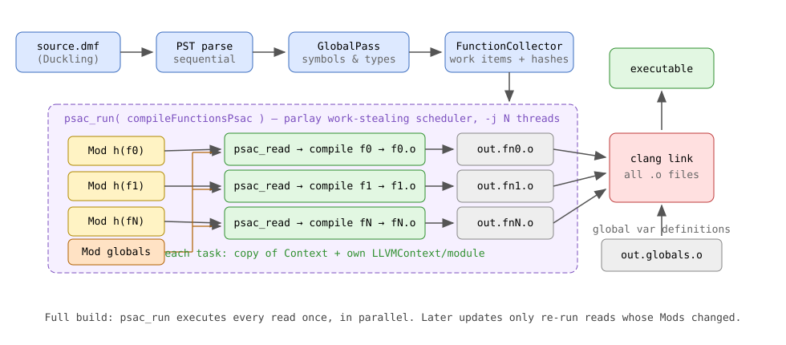
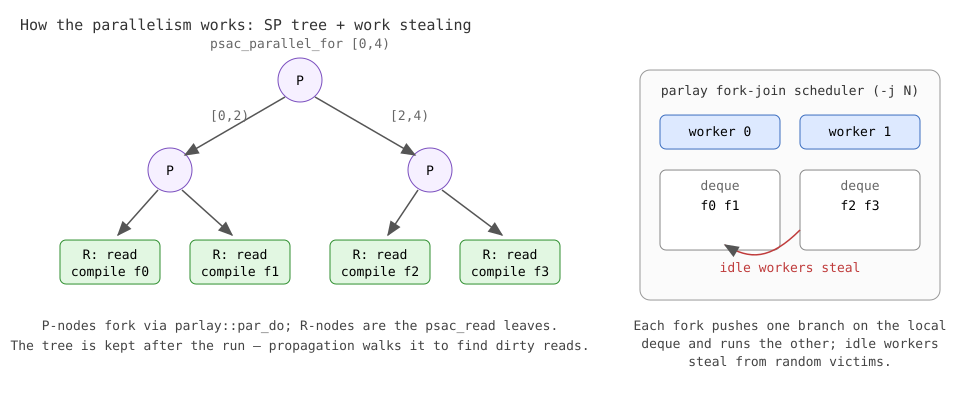
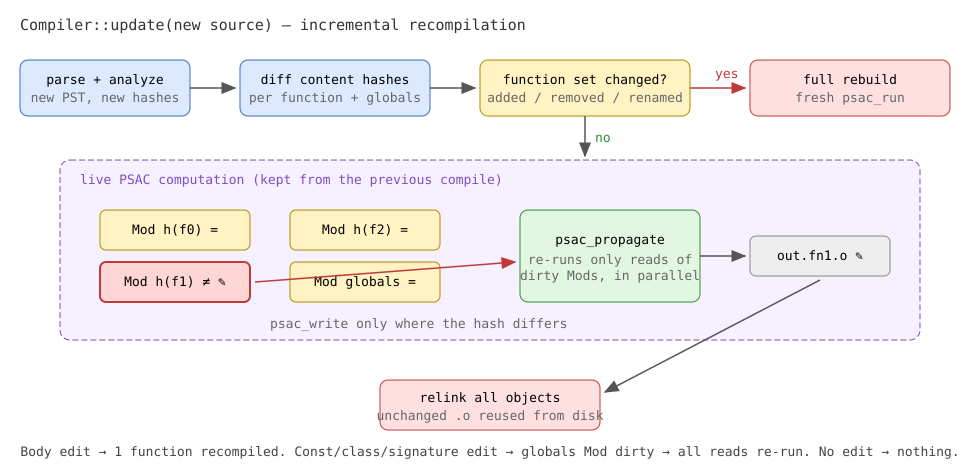

# Psacklinger — a PSAC-parallelized Duckling benchmark compiler

Psacklinger is a small, self-contained compiler for a subset of Duckling, built to
benchmark **PSAC** (Parallel Self-Adjusting Computation,
[paper](https://dl.acm.org/doi/10.1145/3409964.3461799),
[implementation](https://github.com/cmuparlay/psac)) as the engine of a compiler
pipeline. It compiles each function **in parallel** and, when fed new source,
recompiles **only the functions that changed**.

Supported language subset: functions (calls, recursion, forward references, void),
`i64`/`bool`, classes with fields and default constructors (`Point()`), `if`/`while`,
compile-time `const`s, global variables with runtime initializers, namespaces
(accessed with `.`), arithmetic/comparison/logical operators, compound assignments
and the `builtin_output_i64` runtime builtin. Enough to compile the ~8000-line
generated benchmark samples.

## Pipeline



1. **Parse** the source into a PST (sequential).
2. **GlobalPass** registers all top-level declarations — namespaces, function
   signatures, class layouts, consts, globals — into `Context`, a pure-data
   symbol/type/namespace table (`psackling/context.hpp`). This is cheap and stays
   sequential.
3. **FunctionCollector** walks the PST and turns every function definition into a
   *work item*: the `pst::Fun` node, its enclosing namespace, a content hash, and
   its namespace-qualified link name.
4. **PSAC computation** (`psackling/compiler.cpp`, `compileFunctionsPsac`) compiles
   every work item as an independent parallel task. Each task emits its own object
   file `<output>.fnN.o`.
5. A dedicated `<output>.globals.o` defines all global variables
   (zero-initialized) plus the runtime builtins; global initializer expressions —
   which may call functions and read other globals — are lowered in declaration
   order into a synthetic constructor registered in `llvm.global_ctors`, so libc
   runs it before `main`. Function modules only *declare* the globals and
   functions they reference.
6. **Link**: one `clang` invocation over all object files produces the executable.

## How PSAC is used

The whole back-end is one self-adjusting computation:

```cpp
psac_function(compileFunctionsPsac, /* pointers to shared state */) {
    psac_parallel_for(u64 i, 0, n, /*granularity=*/1, {
        psac_read((u64 fn_hash, u64 globals_hash), (&fn_mods[i], globals_mod), {
            compileOneFunction(*base_ctx, items[i], object_paths[i]);
        });
    });
}
```

- Every function gets a **`psac::Mod<u64>` holding its content hash**; one extra
  Mod holds the **globals hash** (classes, consts, global variables, and the
  *signatures* of all functions).
- Each function's compilation is a **`psac_read` of exactly those two Mods**. The
  read body is the dependency declaration: "this object file is a function of
  these two values".
- `psac_run` executes the computation once — that is the parallel full build. The
  returned `psac::Computation` (the dynamic dependency graph) is **kept alive** in
  `pg::Compiler`.
- On an update, the driver rewrites only the Mods whose hashes changed and calls
  `psac_propagate`, which re-executes exactly the dirty reads — again in parallel
  if several functions changed.

Content hashes are derived from each PST element's recursive debug print, which
contains the full structure, names and values but **no source positions or file
identity** — so reformatting, moving a function, or recompiling from a different
file does not invalidate anything.

## How the parallelism works



Two layers:

**PSAC layer — the SP tree.** PSAC programs are series-parallel: `psac_parallel_for`
recursively splits its range (granularity 1 → every function is a leaf) and forks
the halves with `parlay::par_do`, building a tree of P-nodes whose leaves are the
`psac_read` R-nodes. This tree is not just the execution plan — it is *retained*
as the dependency structure, which is what makes change propagation work: a
written Mod marks its reader R-nodes dirty, and propagation walks the SP tree
re-running only dirty subtrees (in parallel, with the same forking).

**Scheduler layer — fork-join work stealing.** `parlay`'s scheduler spawns N
worker threads (`-j/--threads`, default `PARLAY_NUM_THREADS` or hardware
concurrency). Each fork pushes one branch onto the calling worker's local deque
and runs the other branch immediately; idle workers steal from the top of random
victims' deques. Nothing is statically partitioned — load balancing is dynamic, so
one huge function does not stall the others.

**Scheduler parking.** parlay's worker pool is created during *static
initialization* (a global `block_allocator` calls `parallel_for` before `main`)
and its idle workers busy-spin. Left alone, 16 spinning threads thrash caches and
cores through the entire serial front-end, roughly doubling parse time. The driver
therefore parks the pool at a single worker (`parlay::set_num_workers(1)`) and
expands it only around `psac_run`/`psac_propagate`. This one fix roughly halved
full-compile wall time (first measured on Debug builds: ~6 s → ~2.8 s).

**Building with clang.** The vendored psac headers did not compile under clang
(`Computation`'s in-class constructor/destructor instantiate
`unique_ptr<SPNode>` while `SPNode` is still incomplete; GCC defers the
instantiation, clang rejects it). `dependencies/psac_clang_computation_fix.patch`
moves those definitions after `SPNode` and is applied automatically by
`dependencies/Psac.cmake`.

**What made per-function compilation safe to run concurrently:**

- `Context` is decoupled from LLVM and cheaply copyable — each task takes a
  private copy, because lowering inserts local-variable symbols into it.
- Each task owns a private `llvm::LLVMContext` + `llvm::Module`
  (LLVM contexts are not thread-safe). Cross-function calls and global-variable
  accesses become external declarations with namespace-qualified link names
  (`math.add`), resolved by the system linker.
- One-time LLVM target initialization is guarded by `std::call_once`; symbol IDs
  use atomic counters; `StrID` interning is thread-safe.
- Exceptions never unwind into the scheduler: each task catches and records its
  error, and the driver rethrows after the run.

## Incremental recompilation



`pg::Compiler` keeps the computation alive between compiles:

- `compile(file)` — full build (`psac_run`).
- `update(file)` — parse + re-analyze the new source, then **diff the hashes**:
  - body changed → that function's Mod is rewritten → propagation recompiles
    exactly that function;
  - const/class/global/signature changed → the globals Mod is rewritten → every
    function recompiles (the coarse half of dependency tracking; the real compiler
    tracks fine-grained query inputs instead);
  - function added/removed/renamed → the computation shape no longer matches →
    automatic full rebuild;
  - nothing changed → nothing recompiled, no relink.

This mirrors the production compiler's incremental design in miniature: there,
queries depend on per-PST-element stable hashes collected as side inputs
(`driver/incremental_utils/`), and the query framework invalidates whatever
depended on a changed hash. Here, "query" = one function's compilation, and the
"side inputs" are the two Mods it reads.

## Usage

```sh
psacklinger prog.dmf -o prog.out            # parallel build
psacklinger prog.dmf -j 4                   # 4 worker threads
psacklinger prog.dmf --sequential           # no PSAC, baseline for benchmarks
psacklinger prog.dmf -i                     # interactive incremental mode
PSACKLINGER_TIMING=1 psacklinger prog.dmf   # phase timings on stderr
```

Interactive mode reads source paths from stdin after the initial compile — each
line triggers an incremental update (empty line repeats the previous path, `quit`
exits) and prints `recompiled K/N functions`:

```
$ psacklinger a.dmf -o a.out -i
recompiled 2/2 functions
b.dmf            # edited helper() body
recompiled 1/2 functions

recompiled 0/2 functions
```

## Benchmarks vs duckc

`./bench_compiler.sh [input.dmf ...]` builds both compilers (release builds from
`build-release` by default; `BUILD_DIR` overridable) and runs hyperfine over:

- `duckc` — `compile_module`, single-threaded, object files only;
- `duckc-wN` — `compile_packages -w N` (query-framework workers); also compiles
  the std/core packages and links a real executable, the closest equivalent of
  what psacklinger does;
- `psacklinger --sequential` and `psacklinger -j N`.

Everything is cold: duckc's incremental cache and artifacts are wiped before
every timed run. `THREADS`, `RUNS`, `WARMUP` are env-tunable; results land next
to the script as `results_compiler_<name>.{json,md}`.

Release builds, ~8000-line generated samples (`benchmark/data/input`), 5 runs:

| threads | duck1: duckc -w | duck1: psacklinger -j | duck2: duckc -w | duck2: psacklinger -j |
|---:|---:|---:|---:|---:|
| 1 | 671 ms | 667 ms | 1293 ms | 559 ms |
| 2 | 639 ms | 508 ms | 1226 ms | 479 ms |
| 4 | 568 ms | 425 ms | 1201 ms | 454 ms |
| 8 | 551 ms | 400 ms | 1205 ms | 436 ms |
| 16 | 560 ms | **392 ms** | 1206 ms | **440 ms** |

Readings:

- psacklinger wins at every width: ~1.4× on duck1 and ~2.8× on duck2 at -j8.
- duckc's `-w` workers barely help a single big module (1.22× on duck1, flat on
  duck2) — its parallelism is per-query/per-package and one module is dominated
  by a serial task chain. psacklinger's per-function fan-out scales ~1.7×.
- At one thread the two are tied on duck1; on duck2 psacklinger is structurally
  faster regardless of threads.
- Build type matters enormously: the same benchmark on Debug builds reads ~2.8 s
  vs ~5.5–7.6 s — only relative trends survive, absolute Debug numbers don't.

Phase breakdown (`PSACKLINGER_TIMING=1`, duck1 at `-j8`, release): parse 202 ms,
GlobalPass 1 ms, collect+hash 23 ms, globals object 2 ms, function lowering
59 ms, link 54 ms. The shared PST front-end is still the biggest slice —
including its mandatory SHA-256 stable-hash calculation, which psacklinger does
not use (it has its own dprint hashes); an opt-out in `pst::PST` is the next
optimization frontier.

Where the PSAC design pays off unconditionally is incremental recompiles: a
one-function edit re-runs one ~ms-scale task plus a relink instead of a full
compile.

## Tests

`psacklinger_test` (target `psacklinger_test`) runs 84 end-to-end tests: each
compiles a program through the full parallel pipeline, executes it and checks the
exit code. The `Incremental*` tests assert the recompile *counts* — e.g. that a
one-body edit recompiles exactly one function and an unchanged source recompiles
zero.

## Known limitations

- No short-circuit `and`/`or`, named/default arguments, subscripts or methods;
  constructors take no arguments (zero-initialization only).
- Globals dependency is coarse (one hash for everything non-body).
- Integer division is unguarded (`sdiv`), matching the real compiler's LLVM
  backend: division by zero is a SIGFPE, where the DVM backend panics gracefully.
- Templates (`template{...}`) are not implemented — the Duckling frontend has no
  `template` keyword yet; only the baking-site expression `name:{args}` parses.
