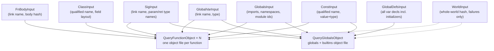

# Querylinger architecture

Querylinger is an incremental compiler for the Psackling language subset (i64 /
bool / char, classes with fields, C-style fixed-size arrays and VLAs, namespaces,
compile-time constants, global variables, multifile imports) whose incremental
engine is the production query framework (`src/common/query_framework`). It exists to answer one question:

> How does a query-graph engine compare against PSAC (self-adjusting
> computation) and against the production compiler, when everything else is
> held equal?

To hold everything else equal, querylinger does not have its own front end or
code generator: it links `libpsackling` and reuses the shared pipeline
(`psac_compiler/psackling/pipeline.{hpp,cpp}`) — the same parser, GlobalPass,
symbol tables, expression lowering and per-function LLVM object emission that
psacklinger uses. The two compilers differ only in how they decide *what to
recompile*.

## The big picture

```
             ┌─────────────────────────────────────────────────────────┐
             │            front end (outside the query graph)          │
  file ────► │  loadModules ─► GlobalPass ─► FunctionCollector + hash  │
             │            = pg::analyzeProgram (shared)                │
             └───────────────┬─────────────────────────────────────────┘
                             │ AnalyzedProgram (PSTs, Context, work items,
                             │ body hashes, per-symbol input hashes)
                             ▼
             ┌─────────────────────────────────────────────────────────┐
             │        ql::Compiler session (querylinger/session.cpp)   │
             │                                                         │
             │  installProgram          SessionState (active session)  │
             │  collectInputs ──► InputData set                        │
             │  invalidateQueries(new, previous)   ◄─ update() only    │
             │  scheduleEntryPoint × (N functions + globals object)    │
             │  await all ─► throw first error ─► link (system clang)  │
             └───────────────┬─────────────────────────────────────────┘
                             │ runs on query workers
                             ▼
             ┌─────────────────────────────────────────────────────────┐
             │  QueryFunctionObject (×N)      QueryGlobalsObject       │
             │  compileOneFunctionToBytes     emitGlobalsObjectBytes   │
             │  private Context copy          private Context copy     │
             │  private LLVMContext/Module    private LLVMContext      │
             │  → object bytes (pure)         → object bytes (pure)    │
             └───────────────┬─────────────────────────────────────────┘
                             │ ObjectResult (bytes)
                             ▼
               session writes changed objects to disk, links
```

The front end is deliberately *not* incremental and *not* query-based — it
re-parses and re-analyzes the whole program on every `compile()`/`update()`,
exactly like psacklinger. This keeps the serial phase identical between the two
compilers, so benchmarks isolate the backend engines. (It is also why a no-op
update costs ~100 ms on the 8000-line corpus: that is the shared re-parse
floor, not query overhead.)

## The query graph

Two query kinds and seven side-input kinds form the graph:



- **`QueryFunctionObject`** (`querylinger/queries/codegen.cpp`) — keyed by the
  function's link name (namespace-qualified, so identity survives body edits and
  reordering). The provider registers its side-input dependencies, then runs the
  shared lowering and returns the object file **bytes** — providers are pure and
  never touch the filesystem; the session writes changed bytes to
  `<output>.fn_<link-hash>.o` after awaiting. Compilation errors are returned as
  data (`ObjectResult::error`), never thrown across the task pool; the session
  rethrows after awaiting.
- **`QueryGlobalsObject`** — produces the object bytes defining all global
  variables (zero-initialized), the runtime builtins, and a synthetic
  `llvm.global_ctors` constructor running the initializer expressions in
  declaration order. Its key is empty: its identity is carried entirely by its
  input dependencies.

### Side inputs: dependencies discovered at the use site

A side input (`DECLARE_QUERY_SIDE_INPUT`) is a leaf node whose *key hash is the
input value*. Querying it records a dependency edge; when the value changes
between compiles, the old node vanishes from the input set and everything that
depended on it is invalidated.

All input keys share one shape (`HashInputKey`): a single SHA-256 hash
(`base::Bit256`, via the `hashing` module — the same algorithm the production
compiler uses for its stable query hashes) folding the symbol's identity and
value together. The hash *is* the 256-bit stable node identity, so collisions
are cryptographically negligible; the input categories are told apart by their
`QueryID`, which is part of the node identity alongside the hash.

The interesting part is *where* the dependencies get registered. The shared
lowering has an observer hook (`pg::SymbolUseObserver` in
`psackling/context.hpp`, null on psacklinger's path) that fires when lowering:

| observer callback | fires in | registers |
|:---|:---|:---|
| `onConstantUse` | `ExprLowering::symbolRefToExpr`, `ConstEval::constantFromSymbol` | `ConstInput` |
| `onFunctionUse` | `LlvmLoweringContext::getOrCreateFunction` | `SigInput` |
| `onGlobalVariableUse` | `LlvmLoweringContext::getOrCreateGlobal` | `GlobalVarInput` |
| `onClassTypeUse` | `LlvmLoweringContext::lowerType` (struct branch) | `ClassInput` |

Querylinger's `SymbolUseRecorder` translates each callback into a
`ctx.query<...Input>(...)` on the emission query's own context. So a function
depends on exactly the constants it reads, the signatures it calls, the classes
it lowers and the globals it touches — no name-resolution query layer needed,
because the dependency set is discovered as a byproduct of doing the work. This
mirrors how the production compiler's `PSTAccessSideInput` registers per-element
dependencies when a query unlocks PST data, one semantic level higher.

Two hash-design details make the granularity useful:

- **Signature hashes cover types, not names** (`pg::functionSigInputHash`): renaming
  a parameter changes only that function's body hash; callers stay cached.
  Changing a return type invalidates the (unchanged) callers, which recompile
  and correctly report the new type error.
- **Global variable inputs split identity/type from initializer**: readers
  depend on `GlobalVarInput` (link name + type), only the globals object
  depends on `GlobalDefsInput` (full declaration content). Editing `var g = 5`
  to `var g = 9` recompiles zero functions — it re-emits one object and relinks.

What remains coarse is `GlobalsInput`: imports, namespace names and module
identity. Rewiring an import can change what any name resolves to, so
everything recompiles — the honest fallback.

All content hashes are dprint-based with the `"position": {...}` prefixes
stripped (`stripPositions` in `pipeline.cpp`); without that, inserting a line
would shift every element's source offsets and re-hash every function below the
edit.

## Session lifecycle and invalidation

`ql::Compiler` (in `querylinger/session.{hpp,cpp}`) owns a `SessionState`:
the analyzed program (PSTs must outlive the work items pointing into them) and
the link-name→work-item index. Providers reach it as a **const** reference
through `activeSession()` — the framework's standard pattern for external data
(the compiler's PST storage guarded by `PSTAccessSideInput` works the same
way), the moral equivalent of psacklinger's PSAC closures capturing `State*`.
It is installed/replaced only on the main thread while no queries run, and
every piece of it a provider reads is covered by a side-input dependency that
provider registers — that invariant is what makes reading external state sound.
The only mutable members are the per-compile recompile counters (atomics,
session-scoped). Object paths, options and the previous compile's `InputData`
set live outside `SessionState`, in the `Compiler`'s private state — providers
never see them.

`update()` is four steps:

1. `pg::analyzeProgram` — full re-parse/re-analyze, outside the graph.
2. `installProgram` + `collectInputs` — compute the new `InputData` set (one
   entry per function body, constant, signature, class, global var, plus the
   defs and structural hashes).
3. `query::external::invalidateQueries(new, previous)` — the framework waits
   for idle workers, diffs `previous − new`, walks the reverse dependency graph
   and erases exactly the dependent nodes, their caches and diagnostics. This
   is `psac_write` + the dirty half of `psac_propagate`.
4. Re-schedule *all* emission queries and await the object bytes. Cached nodes
   return instantly; only invalidated or new nodes execute. The session-scoped
   counters report the recompile counts; the session writes only the objects
   whose bytes changed (tracked by content hash), and if nothing ran and the
   function set is unchanged, the relink is skipped too.

Function set changes need no special casing: an added function is just a new
query node, a removed one drops out of the schedule and the link line, and
survivors stay cached unless something they depend on changed. (Psacklinger now
matches this with one PSAC computation per function.)

**Failures and negative dependencies.** A provider that throws during lowering
never reached its true dependency set — the missing function it called has no
`SigInput` to depend on. Such providers register the `WorldInput` side input
(the whole-world content hash) instead, so the cached failure is retried on any
global-surface change, including the missing symbol finally appearing. Coarse,
but sound — and successful compiles never pay for it.

**Sequential sessions.** The query graph is process-global, but only one
session may be active at a time (asserted), and different programs can share
node identities (every program has `main`). A `ql::Compiler` therefore starts
by invalidating every input node left in the graph
(`query::external::invalidateQueries({})`), which transitively drops all
dependents of a previous session — each session runs on a clean graph instead
of sharing nodes with an unrelated program. The test suite runs hundreds of
sessions in one process this way.

## Threading

- The driver schedules all emission queries up front (`scheduleEntryPoint`),
  reproducing psacklinger's granularity-1 `psac_parallel_for`; the task pool's
  work stealing replaces the parlay scheduler. Nothing from PSAC/parlay links
  into the querylinger binary, so its busy-spinning workers can't distort the
  serial phase.
- Every provider gets a private `pg::Context` copy (local declarations mutate
  symbol tables) and a private `llvm::LLVMContext`/`Module` (LLVM contexts are
  not thread-safe); LLVM target setup is behind `std::call_once`. Same rules as
  psacklinger's worker tasks.
- Worker count is process-global and can be set exactly once
  (`concurrent::worker::setWorkerCount` panics on the second call); the CLI or
  test suite owns it, sessions never touch it.

## What this measures, against what

Both engines now track the same per-symbol dependency granularity (psacklinger
grew per-symbol Mods and per-function computations to match), so the comparison
is pure engine overhead at equal work:

| scenario | psacklinger (PSAC) | querylinger (query graph) |
|:---|:---|:---|
| cold compile, `-j N` | parallel per-function computations | parallel per-function queries |
| no-op update | 0 recompiles, no relink | 0 recompiles, no relink |
| body edit | 1 function | 1 function |
| const edit | readers only | readers only |
| global var initializer | 0 functions, globals object + relink | 0 functions, globals object + relink |
| param rename | 1 function | 1 function |
| class field added | users of the class | users of the class |
| function added/removed | computation created/destroyed | new node / dropped node |
| failed compile, cause fixed | retried via whole-world Mod | retried via `WorldInput` |

`duckc` provides the production baseline with its own (much richer) query
pipeline. Numbers live in `psac_compiler/results_compiler_<name>.md` (cold,
hyperfine) and `psac_compiler/results_incremental_<name>.md` (warm updates).

## Known limitations

- The front end re-runs fully on every update; at the benchmark scale it
  dominates warm-update latency (~100 ms). Making parse/analysis incremental is
  exactly what the production compiler's PST side inputs do, and stays out of
  scope here to keep the psacklinger comparison clean.
- Negative dependencies are tracked only coarsely: a failed compile depends on
  the whole-world `WorldInput`, so it is retried on *any* global-surface change,
  not just the one that could fix it.
- `GlobalsInput` keeps import/namespace changes whole-program coarse.
- Object files accumulate on disk across function renames (stale
  `.fn_<hash>.o` are never linked, but not deleted either).
